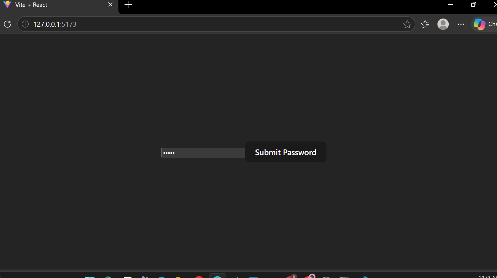
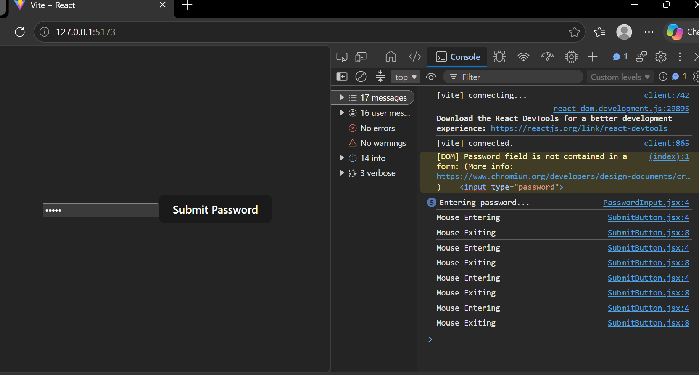

# Lab: Password Input

## Overview
Now that you've learned how to work with events in React, it's time to build something and put those skills to use! Your goal for this lab is to add events in React to practice building event handling.

You are working with a client to create a new password input within their website. They would like to keep track of when the user is typing as well as when the user hovers over and away from the submit button. This is to help with checking the cadence of their typing and the movement of their mouse for the purpose of adding anti-botting security for their user. Your task is to add these three events and functions related to the events so that the security engineer can easily come in and apply their anti-bot measures easily.

## Task 1: Define the Problem
- Create a password input that will track the changing of text and the mouse movements.

## Task 2: Determine the Design
### Determine Component Tree
```
└── App
    ├── PasswordInput
    └── SubmitButton
```
### Isolate/Develop Design per Component
- **App:** displays PasswordInput and SubmitButton. Connected to both.
- **PasswordInput:** password field. Connected to App, next to SubmitButton.
- **SubmitButton:** "Submit Password" button. Connected to App, next to PasswordInput.

## Task 3: Develop the Code
### Create Components
#### PasswordInput:
- Create `PasswordInput` React component
- Render an `<input>` with a password type

#### SubmitButton:
- Create a `SubmitButton` React component
- Render a `<button>` with the text “Submit Password”

### Add Events to Elements
#### PasswordInput:
- Add a change event to the `<input>`

#### SubmitButton:
- Add a mouse enter event to the `<button>`
- Add a mouse leave event to the `<button>`

### Create Event Handler Functions
#### PasswordInput:
- Create a `handleChange` function
- Add a `console.log` to print out “Entering password…”

#### SubmitButton:
- Create a `handleEnter` function
- Add a `console.log` to print out “Mouse Entering”
- Create a `handleLeave` function
- Add a `console.log` to print out “Mouse Exiting”

### Call Function in Respective Event
- `onChange={handleChange}` on the `<input>` in PasswordInput
- `onMouseEnter={handleEnter}` and `onMouseLeave={handleLeave}` on the `<button>` in SubmitButton

## Task 4: Test and Refine
- Debugging and testing during coding
- Ran `npm test` and checked the Console to confirm the events log correctly.

## Task 5: Document and Maintain
### How to Run the Project
1. Run `npm install` to install the dependencies.
2. Run `npm run dev` to start the project.
3. Open the link shown in the terminal (usually http://localhost:5173).
4. Press F12 and open the Console to see the logs when you type and hover over the button.

### Screenshots



## Tools and Resources
- **GitHub Repository:** [React Event Handling Vite Lab](https://github.com/learn-co-curriculum/react-event-handling-vite-lab)
- **Event Handling in React:** [React Documentation](https://react.dev/learn/responding-to-events#adding-event-handlers)

